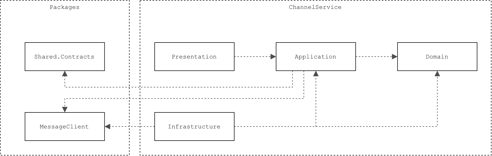

# ChannelService
Manages channels and channel memberships.

## Overview
Supports:
- Creation, retrieval, update, and deletion of channels.
- Creation, retrieval, and deletion of channel memberships, and update of member roles.
- Enforcement of membership rules preventing removal or demotion of the only channel owner.
- Registration of channel activity.

## Architecture
ChannelService follows a layered architecture:
- **Presentation:** Exposes REST endpoints.
- **Application:** Contains application services, contracts, mappings, message handlers, and persistence interfaces.
- **Domain:** Defines domain entities and enums.
- **Infrastructure:** Implements persistence and configures database and RabbitMQ connections.

ChannelService relies on the following shared libraries:
- **Shared.Contracts:** Defines shared event contracts used for communication between services.
- **MessageClient:** Provides reusable messaging functionality for publishing and subscribing to events through RabbitMQ.

<picture>
  <source media="(prefers-color-scheme: dark)" srcset="./docs/figures/architecture-dependency-diagram-dark.png">
  
</picture>

### Domain
ChannelService contains two main entities:
- **Channel:** Represents a channel.
- **Member:** Represents a user's membership in a channel, including their role.

The domain also defines the `MemberRole` enum with three possible roles:
- **Member (0):** Regular channel member.
- **Moderator (1):** Channel moderator.
- **Owner (2):** Channel owner.

### Persistence
ChannelService uses PostgreSQL for persistent storage, accessed through Entity Framework Core.

The database contains two tables:
- **Channel:** Stores channel information.
- **Member:** Stores channel member information.

Persistence is implemented in the Infrastructure layer through:
- `ChannelDbContext`
- `ChannelRepository`
- `MemberRepository`

Entity configurations are defined in:
- `ChannelConfiguration`
- `MemberConfiguration`

<picture>
  <source media="(prefers-color-scheme: dark)" srcset="./docs/figures/er-diagram-dark.png">
  
</picture>

A composite unique index on (ChannelId, UserId) prevents duplicate memberships within the same channel.

### Synchronous Communication
ChannelService exposes REST endpoints for channel and membership management through:
- `ChannelsController`
- `MembersController`

See [API Endpoints](#api-endpoints) for available operations.

### Asynchronous Communication
ChannelService uses RabbitMQ for asynchronous event-driven communication with other services.

Incoming events are processed via `MessagePostedHandler`.

See [Events](#events) for consumed and published events.

## Architecture Flows

### Runtime Flows
The following diagrams provide a high-level overview of how requests are processed through ChannelService.

#### Channel Operations
<picture>
  <source media="(prefers-color-scheme: dark)" srcset="./docs/figures/channel-runtime-flow-diagram-dark.png">
  
</picture>

#### Member Operations
<picture>
  <source media="(prefers-color-scheme: dark)" srcset="./docs/figures/member-runtime-flow-diagram-dark.png">
  
</picture>

### Messaging Flows

#### Handler Registration
Message handlers are automatically discovered and registered during application startup by `MessageHandlerExtensions.AddMessageHandlers()`.

The method scans the assembly for implementations of `IMessageHandler<TMessage>` and registers them in the dependency injection container along with their handler metadata.

#### Event Subscription
Subscriptions are initialized during application startup through the following components:

<picture>
  <source media="(prefers-color-scheme: dark)" srcset="./docs/figures/event-subscription-flow-dark.png">
  
</picture>

- **MessageBackgroundService:** Starts the subscription process.
- **MessageHandlerSubscriptionManager:** Uses registered handler metadata to configure subscriptions.
- **MessageClient:** Establishes subscriptions through RabbitMQ.

#### Event Processing
Incoming events are processed through:

<picture>
  <source media="(prefers-color-scheme: dark)" srcset="./docs/figures/event-processing-flow-dark.png">
  
</picture>

- **MessageClient:** Receives an event and forwards it to the registered message handler.
- **MessageHandlerSubscriptionManager:** Resolves the appropriate message handler.
- **MessageHandler:** Processes the event through its `HandleAsync()` implementation.

## API Endpoints

### Channels
| Method | Endpoint | Description | Request Body | Responses |
|---|---|---|---|---|
| POST | `/channels` | Create a channel | `CreateChannelRequest` | 201 |
| GET | `/channels` | Retrieve all channels | — | 200 |
| GET | `/channels/{id}` | Retrieve a channel by ID | — | 200, 404 |
| PUT | `/channels/{id}` | Update a channel | `UpdateChannelRequest` | 204, 404 |
| DELETE | `/channels/{id}` | Delete a channel | — | 204, 404 |

API endpoints for channels are implemented in `ChannelsController`.

### Members
| Method | Endpoint | Description | Request Body | Responses |
|---|---|---|---|---|
| POST | `/channels/{channelId}/members` | Add a member to a channel | `AddMemberRequest` | 201, 404, 409 |
| GET | `/channels/{channelId}/members` | Retrieve all channel members | — | 200, 404 |
| GET | `/channels/{channelId}/members/{userId}` | Retrieve a specific member | — | 200, 404 |
| PATCH | `/channels/{channelId}/members/{userId}` | Update a member's role | `UpdateMemberRoleRequest` | 204, 404, 409 |
| DELETE | `/channels/{channelId}/members/{userId}` | Remove a member | — | 204, 404, 409 |

API endpoints for channels are implemented in `MembersController`.

### Path Parameters
| Parameter | Type | Required | Description |
|---|---|---|---|
| `id` | GUID | Yes | Channel identifier |
| `channelId` | GUID | Yes | Channel identifier |
| `userId` | GUID | Yes | User identifier |

All path parameters are required.

### Request Bodies

#### CreateChannelRequest 
Used by `POST /channels`.  

| Property | Type | Required | Description |
|---|---|---|---|
| `ownerUserId` | GUID | Yes | Identifier of the initial channel owner |
| `name` | string | Yes | Channel name (max. 100 characters) |
| `description` | string | No | Channel description (max. 400 characters) |

Example: 
```json
{
  "ownerUserId": "0b53a2e2-ed57-4372-831c-a44d763140f6",
  "name": "General",
  "description": "General discussions"
}
```

#### UpdateChannelRequest
Used by `PUT /channels/{id}`.

| Property | Type | Required | Description |
|---|---|---|---|
| `name` | string | Yes | Channel name (max. 100 characters) |
| `description` | string | No | Channel description (max. 400 characters) |

Example:
```json
{
  "name": "Announcements",
  "description": null
}
```

Omitting `description` or setting it to `null` clears the existing description.

#### AddMemberRequest
Used by `POST /channels/{channelId}/members`.

| Property | Type | Required | Description |
|---|---|---|---|
| `userId` | GUID | Yes | Public identifier of the user to add (must not be an empty GUID) |

Example:
```json
{
  "userId": "0b53a2e2-ed57-4372-831c-a44d763140f6"
}
```

#### UpdateMemberRoleRequest
Used by `PATCH /channels/{channelId}/members/{userId}`.
| Property | Type | Required | Description |
|---|---|---|---|
| `role` | MemberRole | Yes | New role assigned to the member |

Example:
```json
{
  "role": 1
}
```

Possible values:
- `0` — Member
- `1` — Moderator
- `2` — Owner

The only channel owner cannot be demoted.

### HTTP Responses
| Status | Description |
|---|---|
| 200 OK | Resource retrieved successfully |
| 201 Created | Resource created successfully |
| 204 No Content | Resource updated or deleted successfully |
| 400 Bad Request | Request validation failed |
| 404 Not Found | Requested channel or member does not exist |
| 409 Conflict | Operation conflicts with membership rules |

The API returns `409 Conflict` when:
- Adding a user who is already a channel member.
- Demoting the only channel owner.
- Removing the only channel owner.

### Response Bodies

#### ChannelResponse
Returned by:
- `POST /channels`
- `GET /channels`
- `GET /channels/{id}`

| Property | Type | Nullable | Description |
|---|---|---|---|
| `id` | GUID | No | Public channel identifier |
| `name` | string | No | Channel name |
| `description` | string | Yes | Channel description |
| `createdAt` | DateTime | No | Channel creation timestamp |
| `lastUpdatedAt` | DateTime | Yes | Timestamp of the last channel update |
| `lastActivityAt` | DateTime | Yes | Timestamp of the last activity in the channel |

`GET /channels` returns a collection of `ChannelResponse` objects.

#### MemberResponse
Returned by:
- `POST /channels/{channelId}/members`
- `GET /channels/{channelId}/members`
- `GET /channels/{channelId}/members/{userId}`

| Property | Type | Nullable | Description |
|---|---|---|---|
| `channelId` | GUID | No | Public channel identifier |
| `userId` | GUID | No | Public user identifier |
| `role` | MemberRole | No | Member's role in the channel |
| `joinedAt` | DateTime | No | Timestamp when the user joined the channel |
| `lastUpdatedAt` | DateTime | Yes | Timestamp of the last membership update |

`GET /channels/{channelId}/members` returns a collection of `MemberResponse` objects.

## Events
ChannelService communicates asynchronously through RabbitMQ using event contracts defined in `Shared.Contracts`:
- **MessagePostedEvent:** Consumed to update the channel's last activity timestamp when a message is posted.
- **ActivityProcessedEvent:** Published after channel activity has been successfully processed.

## Running the Project with Docker
> Note: The following commands should be run from the repository root.

### Start
```bash
docker compose -f apps/channel-microservice/docker-compose.yml up -d --build
```

### Stop
```bash
docker compose -f apps/channel-microservice/docker-compose.yml down
```

### Logs
```bash
docker compose -f apps/channel-microservice/docker-compose.yml logs -f
```

### Configuration
The application requires configuration for:
- PostgreSQL database connection.
- RabbitMQ connection.

## Testing
ChannelService includes unit, contract, and integration tests using xUnit, Moq, and FluentAssertions.
- **Unit Tests:** Verify individual components in isolation using mocked dependencies.
- **Contract Tests:** Verify that message handlers can process events defined in `Shared.Contracts`.
- **Integration Tests:** Verify asynchronous communication through RabbitMQ and PostgreSQL.

### Running Tests
> Note: The following command should be run from the repository root.

```bash
dotnet test apps/channel-microservice/tests/ChannelService.Tests
```

Integration tests require the system to be running as described in [Running the Project with Docker](#running-the-project-with-docker).